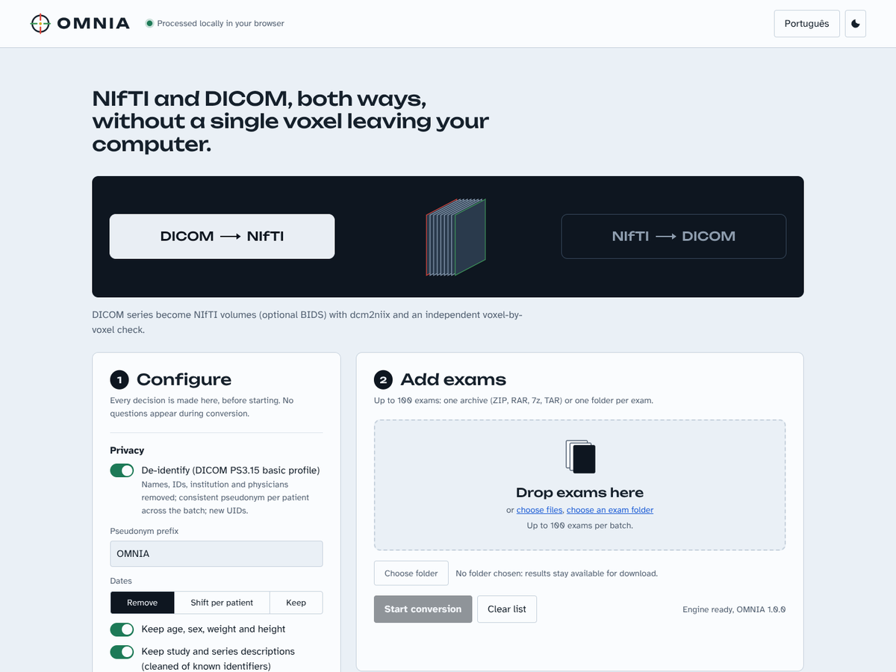

<p align="center">
  
</p>

<h1 align="center">OMNIA</h1>

<p align="center"><b>NIfTI ⇄ DICOM, both ways, without a single voxel leaving your computer.</b><br>
A converter for CT and MR that runs entirely in the browser, checks every voxel it writes, and handles batches of up to 100 exams.</p>

<p align="center">
  <a href="LICENSE"></a>
  
  
</p>

<p align="center"></p>

<p align="center"><b>Use it online: <a href="https://omniaco.netlify.app">omniaco.netlify.app</a></b> · Chrome or Edge recommended</p>

<p align="center"><i>Author: <b>Klaus Schumacher, MD</b> · Contributor: <b>Dr. Heraldo Mello Neto</b></i><br>
<a href="#em-português">Leia em português ↓</a></p>

---

## What OMNIA does

| Direction | Input | Output |
|---|---|---|
| **DICOM → NIfTI** | Exams as ZIP, RAR, 7z, TAR or folders (nested archives and DICOMDIR included) | NIfTI (`.nii.gz` or `.nii`) with JSON sidecars, optionally organised as **BIDS**; DWI with `.bval`/`.bvec` |
| **NIfTI → DICOM** | NIfTI-1/NIfTI-2 volumes (3D, 4D, DWI) and label maps | Classic **CT Image** or **MR Image** series, and **DICOM SEG** for segmentations |

- **You choose the direction.** Every decision is taken once, before the batch starts. No question ever interrupts a conversion.
- **Batches of up to 100 exams**, one archive (or folder) per exam, each with its own progress track, result, checksums and visual check.
- **Lossless by default.** Nothing is resampled or quantised silently. When something cannot be represented exactly, the exam is refused with a reason, or converted with the exact error you allowed and measured.
- **Independent verification of every output.** OMNIA re-reads what it wrote through a separate code path and compares every voxel with the source.
- **De-identification** (DICOM PS3.15 Basic Profile) with a consistent pseudonym per patient across the batch, new UIDs, optional date shifting, and **face removal for head CT**.
- **Private by construction.** Conversion happens in a Web Worker with WebAssembly. The page's Content Security Policy blocks any upload: the browser itself refuses to send image data anywhere.

OMNIA is a research and teaching tool. It is not a medical device and is not intended for diagnosis.

## Using OMNIA

Open **https://omniaco.netlify.app** (Chrome or Edge for writing results straight into a folder), or run it on your own computer (see *Run it locally*).

1. **Choose the direction**: DICOM → NIfTI or NIfTI → DICOM.
2. **Configure** (left panel). These are all the decisions of the batch:
   - *Privacy*: de-identify (on by default), pseudonym prefix, dates (remove, shift per patient, keep), keep age/sex/weight/height, keep cleaned descriptions, remove the face (head CT) and what to do when that is not possible.
   - *DICOM → NIfTI*: `.nii.gz` or `.nii`, BIDS layout, skip localizers, skip secondary reconstructions (MPR/MIP/3D), minimum images per series, irregular slice spacing (split losslessly, interpolate, or skip), gantry tilt (exact sheared geometry or resample).
   - *NIfTI → DICOM*: modality when the NIfTI does not say (MR/CT), reference orientation (sform/qform), values (lossless only, or allow quantisation with the error reported), masks (detect, always image, always SEG), segmentation origin and algorithm name, optional per-exam metadata CSV.
   - *Archives*: password, if your archives use one.
3. **Add exams**: drop archives or folders, or pick them. Optionally choose a destination folder (Chrome/Edge): results are written there as they finish; otherwise they stay available for download.
4. **Start**. Each exam shows five stages (reading, inventory, conversion, packaging, ready), its status and, on demand, the per-series details, SHA-256 of input and output, and a visual check (three orthogonal planes; before/after renderings for face removal).
5. At the end, download the **CSV and JSON reports** and, when de-identifying, the **pseudonym map** (marked confidential: it links pseudonyms to the original identities and is only written to your computer).

### Output layout

DICOM → NIfTI with BIDS (default):

```
OMNIA-0001_E01_BIDS.zip
└── sub-OMNIA0001/ses-01/
    ├── anat/sub-OMNIA0001_ses-01_acq-…_run-5_T1w.nii.gz (+ .json)
    ├── dwi/ …_dwi.nii.gz, .bval, .bvec, .json
    └── func/ …_bold.nii.gz (+ .json)
```

NIfTI → DICOM:

```
OMNIA-0001_E01.zip
└── OMNIA-0001_E01/
    ├── 001_T1_MPRAGE/IM0001.dcm …   (MR Image Storage)
    └── 002_SEG_lesion_seg/SEG_0001.dcm (Segmentation Storage, references series 001)
```

## How the conversion is guaranteed

**NIfTI → DICOM (OMNIA's own engine)**

- *Geometry.* Slice positions and orientation come from the NIfTI affine (sform by default, qform on request), converted from RAS to DICOM LPS. Images are laid out in the conventional radiological orientation, and the same voxels are kept: nothing is resampled. In-plane shear, which DICOM cannot represent, is refused. Gantry-tilted grids are written exactly.
- *Values.* Values are stored as 16-bit integers with Rescale Slope/Intercept only when this representation is exact (directly, on an integer lattice, or on a floating-point lattice checked voxel by voxel, using the very decimal strings a reader will see). Otherwise the exam is refused, unless you allowed quantisation; then the maximum error is measured and written to the report and to the DICOM header.
- *Metadata cascade.* Acquisition and patient fields come, in order, from a reference DICOM (when the exam contains one), the BIDS sidecar, your CSV, and defaults; the source used for each group of fields is recorded in the report. DWI b-values and gradient directions are converted from FSL conventions to the DICOM patient frame.
- *DICOM SEG.* Label maps become binary DICOM SEG objects that reference the image series converted in the same exam, with label names from ITK-SNAP, JSON, CSV or FreeSurfer tables when provided.
- *Self-check.* After writing, every instance is parsed again and each voxel and position is compared with the NIfTI.

**DICOM → NIfTI (dcm2niix)**

- Conversion uses [dcm2niix](https://github.com/rordenlab/dcm2niix) (Chris Rorden, BSD-2-Clause), compiled to WebAssembly. On the public test data, the browser build produces the same files as the native program (186/186 images and sidecars identical).
- OMNIA then checks the result independently: every uncompressed classic DICOM image is located in the NIfTI written by dcm2niix and compared value by value; for enhanced multi-frame objects and compressed pixels, the position of every frame is checked. Anything that does not match is refused.
- Irregular slice spacing is split into uniform blocks (lossless) by default. Gantry tilt is written with the exact sheared affine taken from the image positions, instead of an approximation.

**Face removal (head CT)**

OMNIA finds the intracranial volume (soft tissue enclosed by bone), builds its convex hull in the sagittal plane and places a cutting plane at 45° tangent to it, on the anterior-inferior side, with a 4 mm margin. Every voxel denser than air beyond the plane becomes air (−1000 HU). By construction the plane never crosses the intracranial volume. A frontal rendering before and after is shown for each exam; always look at it.

## Validation

All numbers below come from scripts in this repository, run on public data that anyone can download (see *Reproduce*). Full results: [docs/VALIDATION.md](docs/VALIDATION.md).

| Test | Data | Result |
|---|---|---|
| NIfTI → DICOM, real volumes | 191 reference NIfTIs from 12 dcm_qa datasets (5 vendors, CT and MR) | **189/189** converted losslessly (45950 DICOM instances) and confirmed voxel by voxel by an independent pydicom + nibabel check; **186/186** native dcm2niix round trips identical (3 gantry-tilted series not comparable); **0** dciodvfy errors; 2 RGB maps refused by design |
| DICOM → NIfTI | the same 12 datasets, packed as exams | **190/190** NIfTI outputs confirmed independently (186 identical to native dcm2niix, 4 checked directly against the DICOM images); 169 series converted, 11 skipped by the default filters, 0 errors |
| De-identification | 22930 names, IDs, dates, UIDs and site identifiers from the source headers | **0** found in any output file outside technical fields |
| dcm2niix in the browser vs native | 186 NIfTI from 12 datasets | **186/186** identical (image and sidecar) |
| Synthetic edge cases | 28 cases (oblique, flipped, float, NIfTI-2, big-endian, DWI, SEG, refusals) | **28/28** as expected |
| Browser end to end | 5 exams (ZIP, RAR5, nested ZIP; MR + SEG; head CT with face removal) in headless Chromium | all converted; **44/44** NIfTI identical to native dcm2niix; **3/3** DICOM series and SEG exact; face removal changed no intracranial voxel |
| Unit tests | geometry property test (200 random grids), encoder, DICOM I/O, de-identification, ZIP, NIfTI | **40/40** pass |

### Reproduce

```bash
npm ci                                   # dependencies (Node 20+)
bash tools/fetch_test_data.sh ../omnia-data   # public test data, pinned commits
bash tools/validate_all.sh ../omnia-data ../omnia-reports
```

Requirements: Python 3 with `numpy nibabel pydicom scipy highdicom` (and `rars` to build the RAR test exam), native `dcm2niix` and `dciodvfy` (dicom3tools) on the PATH. `npm test` runs the unit tests alone.

## Privacy and security

- Images are read, converted and written by the browser. The Content Security Policy (`connect-src 'self'`) forbids requests to any other origin, and the only request made to the site itself is the access email.
- The access email is the only personal data stored by the site (Netlify Blobs). It is used as a contact list for release notices; anyone can ask for deletion by replying to the code email.
- ZIP files written by OMNIA carry no timestamps. Reports and the pseudonym map are only ever written to your computer.
- De-identification follows the DICOM PS3.15 Basic Profile with the options shown in the interface; the profile and options used are recorded in each output (`DeidentificationMethod` in DICOM, `OMNIADeidentification` in the JSON sidecar). De-identification of free text is best effort: review descriptions before sharing data, and consider burned-in text in secondary captures (skipped by default).

## Known limits

- RGB and complex NIfTI data are not converted to DICOM.
- Mosaic series (Siemens, United Imaging) are converted by dcm2niix but cannot be checked voxel by voxel by OMNIA (their outputs are identical to native dcm2niix in the validation).
- Compressed DICOM (JPEG, JPEG 2000, JPEG-LS, RLE) is decoded by dcm2niix; OMNIA's own voxel check covers uncompressed images.
- Face removal is available for CT only. Encrypted RAR archives are not supported (re-pack them as ZIP).
- Writing directly to a folder needs the File System Access API (Chrome or Edge); other browsers download the results.

## Run it locally

```bash
git clone https://github.com/ks-schumacher/omnIA.Co.git
cd omnIA.Co
npm ci
npm start          # builds into dist/ and serves http://localhost:8080 with the production security headers
```

Running locally there is no access gate (the email functions only exist on Netlify).

## Deploy your own (Netlify)

1. Import the repository in Netlify. `netlify.toml` already sets the build (`npm ci --omit=dev && npm run build`), the `dist` folder, the functions and the security headers.
2. Optional environment variables for the access gate:
   - `RESEND_API_KEY` **or** `SMTP_USER` + `SMTP_PASS` (+ `SMTP_HOST`, `SMTP_PORT`, default Gmail SSL 465): sending of the 6-digit codes. Without them, the gate runs in *preview mode*: the email is recorded (unverified) and access is granted.
   - `MAIL_FROM`: sender address.
   - `CODE_SECRET`: HMAC key for codes and tokens (generated and stored automatically if absent).
   - `ADMIN_KEY`: enables `GET /api/leads` (header `x-admin-key`), which returns the contacts as CSV.

## Project structure

```
src/engine/      conversion engine (pure ES modules, shared by the browser worker and the Node test CLIs)
  dicom/         DICOM dictionary, reader (all common transfer syntaxes) and Part 10 writer
  nifti.js       NIfTI-1/2 reader and writer (gzip, big-endian, .hdr/.img)
  geometry.js    RAS↔LPS, slice planning, reference grid matching
  pixels.js      exact 16-bit encoding planner
  nii2dcm.js     CT/MR image series and DICOM SEG builders
  verify.js      independent re-read and voxel checks (both directions)
  exam.js        one exam end to end: inventory, filters, conversion, verification, packaging
  anon.js        de-identification and pseudonyms
  deface.js      CT face removal
src/worker/      Web Worker (dcm2niix WASM, libarchive WASM, hashing, ZIP)
src/app/         interface (HTML, CSS, JS, PT/EN)
netlify/         access gate functions (email code, contacts export)
test/            unit tests (node --test), validation scripts (Python), browser end-to-end test
tools/           data fetching, full validation, DICOM dictionary generator
```

## Licence and credits

OMNIA is released under the [Apache License 2.0](LICENSE) © 2026 Klaus Schumacher, MD. It can be used, modified and distributed, including commercially, under the terms of the licence.

Third-party components keep their own licences (full texts in [THIRD_PARTY_NOTICES.md](THIRD_PARTY_NOTICES.md)): dcm2niix (BSD-2-Clause) via @niivue/dcm2niix, with OpenJPEG (BSD-2-Clause) and CharLS (BSD-3-Clause); libarchive.js (MIT) with libarchive (BSD) and Comlink (Apache-2.0); fflate (MIT), @noble/hashes (MIT), Unbounded and Atkinson Hyperlegible fonts (SIL OFL 1.1). The DICOM dictionary is generated from pydicom (MIT). Test data: the dcm_qa collections by Chris Rorden and collaborators (BSD-2-Clause) and the niivue demo images (CT courtesy of Philips Medical).

If OMNIA is useful in your work, please cite it ([CITATION.cff](CITATION.cff)).

---

## Em português

**OMNIA converte NIfTI em DICOM e DICOM em NIfTI dentro do navegador, sem que nenhuma imagem saia do seu computador.** Atende TC e RM de qualquer região, lotes de até 100 exames, e confere cada voxel que grava.

### O que faz

- **DICOM → NIfTI**: exames em ZIP, RAR, 7z, TAR ou pastas (inclusive arquivos aninhados e DICOMDIR) viram NIfTI com sidecar JSON, opcionalmente em **BIDS**; DWI com `.bval`/`.bvec`. A conversão usa o dcm2niix compilado em WebAssembly, e o OMNIA confere depois cada imagem DICOM contra o NIfTI gerado.
- **NIfTI → DICOM**: volumes 3D, 4D e DWI viram séries **CT Image** ou **MR Image** clássicas; mapas de rótulos viram **DICOM SEG**, que referencia a série convertida no mesmo exame.
- **Você decide o sentido**, e todas as decisões são tomadas antes de começar. Nenhuma pergunta interrompe o lote.
- **Sem perdas por padrão**: nada é reamostrado nem quantizado em silêncio. Se algo não puder ser representado exatamente, o exame é recusado com o motivo, ou convertido com o erro máximo que você autorizou, medido e registrado.
- **Desidentificação** pelo perfil básico do DICOM PS3.15, com pseudônimo consistente por paciente no lote, novos UIDs, opção de deslocar datas e **remoção da face em TC de crânio**.
- **Privacidade por construção**: a política de segurança da página impede qualquer envio de dados de imagem. Só o e-mail de acesso é transmitido.

### Como usar

Abra **https://omniaco.netlify.app** (Chrome ou Edge, para gravar os resultados direto numa pasta) ou rode no seu computador (veja abaixo).

1. Escolha o sentido da conversão.
2. Configure privacidade, formato e políticas no painel 1.
3. Arraste os exames (um arquivo compactado ou uma pasta por exame). No Chrome ou Edge, escolha uma pasta de destino para gravar os resultados à medida que ficam prontos.
4. Clique em **Iniciar conversão** e acompanhe cada exame (leitura, inventário, conversão, empacotamento, pronto), com detalhes por série, SHA-256 e conferência visual.
5. Baixe os relatórios CSV e JSON e, se houver desidentificação, o **mapa de pseudônimos (sigiloso)**, que fica apenas no seu computador.

### Validação

| Teste | Dados | Resultado |
|---|---|---|
| NIfTI → DICOM, volumes reais | 191 NIfTI de referência de 12 conjuntos dcm_qa (5 fabricantes, TC e RM) | **189/189** convertidos sem perdas (45.950 instâncias DICOM) e confirmados voxel a voxel por uma checagem independente (pydicom + nibabel); **186/186** idas e voltas pelo dcm2niix nativo idênticas (3 séries com gantry inclinado não comparáveis); **0** erros no dciodvfy; 2 mapas RGB recusados por projeto |
| DICOM → NIfTI | os mesmos 12 conjuntos, como exames | **190/190** volumes NIfTI confirmados de forma independente (186 idênticos ao dcm2niix nativo e 4 conferidos diretamente contra as imagens DICOM); 169 séries convertidas, 11 descartadas pelos filtros padrão, 0 erros |
| Desidentificação | 22.930 nomes, IDs, datas, UIDs e identificadores de instituição dos cabeçalhos | **0** encontrados nos arquivos gerados, fora de campos técnicos |
| dcm2niix no navegador × nativo | 186 NIfTI de 12 conjuntos | **186/186** idênticos (imagem e sidecar) |
| Casos-limite sintéticos | 28 casos (oblíquos, invertidos, float, NIfTI-2, big-endian, DWI, SEG, recusas) | **28/28** conforme esperado |
| Ponta a ponta no navegador | 5 exames (ZIP, RAR5, ZIP aninhado; RM + SEG; TC de crânio com remoção da face) no Chromium | todos convertidos; **44/44** NIfTI idênticos ao dcm2niix nativo; **3/3** séries DICOM e SEG exatas; a remoção da face não alterou nenhum voxel intracraniano |
| Testes unitários | teste de propriedade geométrico (200 grades aleatórias), codificador, DICOM, desidentificação, ZIP, NIfTI | **40/40** aprovados |

Os números completos estão em [docs/VALIDATION.md](docs/VALIDATION.md), e qualquer pessoa pode reproduzi-los com `tools/fetch_test_data.sh` e `tools/validate_all.sh`.

### Rodar localmente

```bash
git clone https://github.com/ks-schumacher/omnIA.Co.git && cd omnIA.Co
npm ci
npm start   # http://localhost:8080
```

### Licença e autoria

Apache License 2.0 © 2026 **Klaus Schumacher, MD**. Contribuidor: **Dr. Heraldo Mello Neto**. Uso comercial permitido nos termos da licença. Ferramenta de pesquisa e ensino, sem finalidade diagnóstica.
